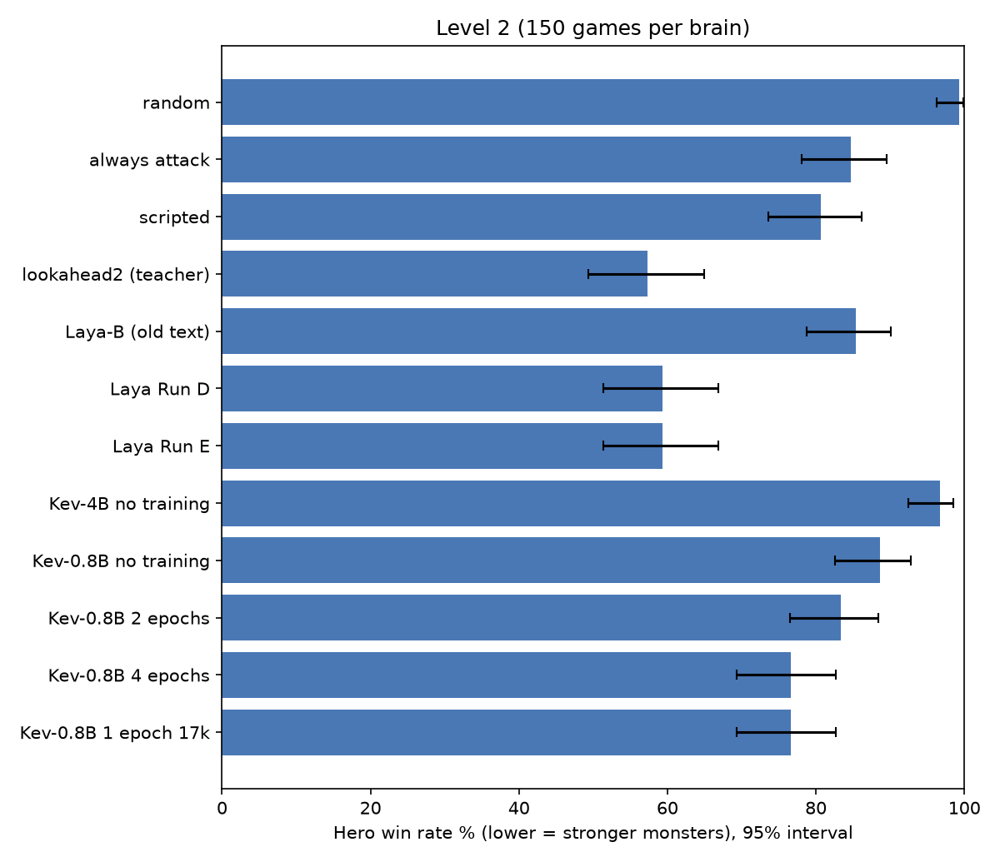
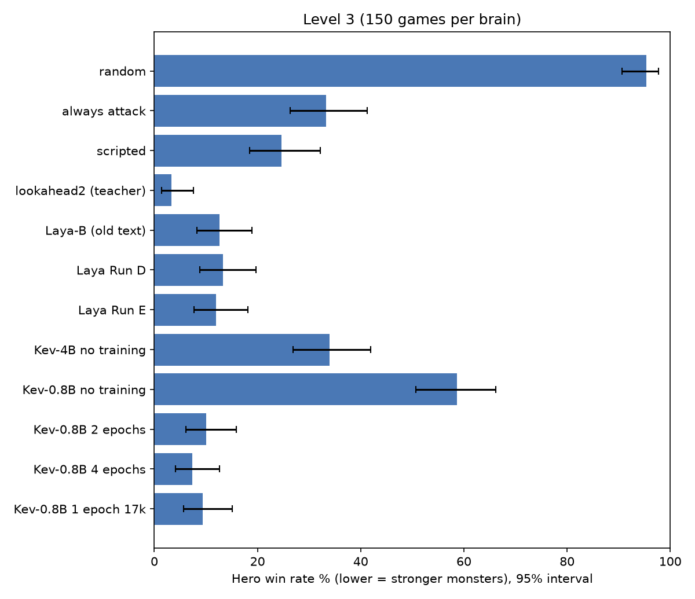
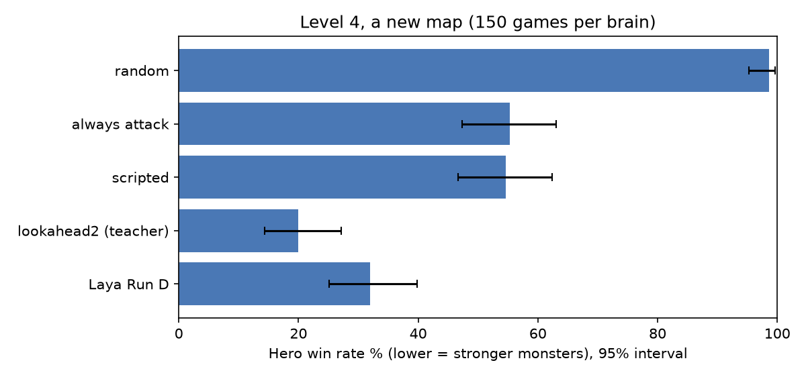

# Squad Tactics vs. a Team of Fast AI Brains: project report (DRAFT, 2026-11-27)

## 1. What this is
A turn-based tactics game in the browser. The player controls 3 heroes (Tank, Archer, Healer). Up to 10 monsters fight as a team: they plan one by one, each seeing the earlier plans, and the plans are shown before they play out. Code does all the thinking (distances, line of sight, legal moves, damage, tile choice). A small open "System 1" model only picks one option from a short legal list for each monster. The goal was a playable, fun game plus a fair comparison of monster brains.

## 2. Brains compared
- **random**, **always attack**, **scripted** (hand-made rules, frozen), **lookahead2** (a code teacher that simulates the rest of the round for every option).
- **Laya** (421M encoder, all weights fine-tuned): Laya-A copies scripted; Laya-B, Run C, D and E copy lookahead2. Run D is the best candidate (it adds one line to the text: "Heroes that can hit you here next turn").
- **Kev** (Qwen3.5 base + small adapter): 4B and 0.8B without training, and 0.8B fine-tuned (2 epochs, 4 epochs, and one epoch over double the data). Kev-4B was not fine-tuned: it does not fit training on a free T4 without a precision change.
- Jev (hosted, paid) was cut for cost.

## 3. Results
Held-out games: seeds 0 to 49, 3 hero bots, shuffled starts, 150 games per level. Hero win % (lower = stronger monsters), 95% Wilson interval. Level 1 separates no brain (everyone 100%).

| Brain | Level 2 | Level 3 |
|---|---|---|
| random | 99.3 | 95.3 |
| always attack | 84.7 [78.0, 89.6] | 33.3 [26.3, 41.2] |
| scripted | 80.7 [73.6, 86.2] | 24.7 [18.5, 32.1] |
| lookahead2 (teacher) | 57.3 | 3.3 |
| Laya-A | 81.3 [74.3, 86.8] | 25.3 [19.0, 32.8] |
| Laya-B (old text) | 85.3 [78.8, 90.1] | 12.7 [8.3, 18.9] |
| Laya run C (old text, soft loss) | 85.3 [78.8, 90.1] | 8.7 [5.1, 14.3] |
| **Laya Run D** | **59.3 [51.3, 66.9]** | **13.3 [8.8, 19.7]** |
| Laya Run E (double data) | 59.3 [51.3, 66.9] | 12.0 [7.7, 18.2] |
| Laya Run F (DAgger data) | 70.0 [62.2, 76.8] | 10.0 [6.2, 15.8] |
| Laya Run D, second training seed | 64.0 [56.1, 71.2] | 4.0 [1.8, 8.5] |
| Kev-4B, no training | 96.7 [92.4, 98.6] | 34.0 [26.9, 41.9] |
| Kev-0.8B, no training | 88.7 [82.6, 92.8] | 58.7 [50.7, 66.2] |
| Kev-0.8B, 2 epochs | 83.3 [76.6, 88.4] | 10.0 [6.2, 15.8] |
| Kev-0.8B, 2 epochs, learning rate 1e-4 | 77.3 [70.0, 83.3] | 12.7 [8.3, 18.9] |
| Kev-0.8B, 4 epochs | 76.7 [69.3, 82.7] | 7.3 [4.1, 12.7] |
| Kev-0.8B, 1 epoch over 17,007 rows | 76.7 [69.3, 82.7] | 9.3 [5.6, 15.1] |

**Level 4 (a new map, same monsters, never seen in training)**, Run D: 32.0 [25.1, 39.8]; Run F: 49.3 [41.4, 57.3]; Run D second seed: 34.7 [27.5, 42.6]; lookahead2 20.0 [14.4, 27.1]; scripted 54.7 [46.7, 62.4]; always attack 55.3 [47.3, 63.1]; random 98.7 [95.3, 99.6].

**Speed per decision:** Laya on a T4 about 30 ms; Laya on a laptop CPU 4 to 7 s; Kev-0.8B about 160 to 210 ms; Kev-4B about 0.9 to 1.2 s (all on a T4). Zero fallbacks to scripted in every model run.

## 4. What we found
1. A text change mattered more than model changes: adding the line about which heroes can hit the monster next turn moved Level 2 from 85.3% to 59.3% (same data and settings, only the text differed).
2. Run D is clearly better than scripted on Levels 2 and 4 (intervals do not overlap) and within about 2 points of its teacher on Level 2. On Level 3 it is 11 points better than scripted, but the intervals touch (19.7 vs 18.5), so this is not shown as clear. It is about 10 points behind the teacher on Level 3 and 12 points behind on Level 4 (intervals overlap). Run D closes about 91% (Level 2), 53% (Level 3) and 65% (Level 4) of the gap between scripted and the teacher (own calculation). These numbers are for the first Run D training run; the second run is in finding 9.
3. More data of the same kind did not help, for Laya (Run D vs Run E) or for Kev. A higher learning rate for Kev-0.8B (1e-4) did not close the Level 2 gap either (77.3 vs 83.3, intervals overlap).
4. Shadow run (Run D plays, the teacher scores the same states, Levels 3 and 4, 10,312 decisions): agreement with the teacher 79.8%. Most of the lost value is in rounds 6 to 10, where Laya attacks when the teacher prefers a positional move (advance, flank, protect, hold, heal). The training data has few examples of those choices. The scores are the teacher's own estimates, so this is a lead, not proof.
5. Option order: when the options were shown in reverse order, Run D made the same choice 97.1% of the time (2,209 decisions, Levels 2 and 3). Win rates with reversed options, 150 games per level (the same games as the normal order): Level 2 59.3 [51.3, 66.9] normal vs 70.7 [62.9, 77.4] reversed; Level 3 13.3 [8.8, 19.7] vs 14.0 [9.3, 20.5]. Level 3 shows no difference. On Level 2 the reversed order is about 11 points worse; the intervals overlap, so by our rule no difference is shown, but the estimate points the same way as in the earlier 30-game test (probably part of these games), so a Level 2 order effect is plausible. Only one alternative order was tested, and training used shuffled order.
6. Kev without training is weak on this game; fine-tuning took Kev-0.8B from 58.7% to about 10% on Level 3, but on Level 2 it stays near scripted. It is about 5 times slower than Laya, so it does not suit the live game.
7. The scripted teacher almost never chooses Flank, so no model could learn it.
8. DAgger (Run F: Run D data plus 8,540 rows labelled by the teacher on Laya's own games) missed all three pass lines that were fixed before the run. Level 3: 10.0 [6.2, 15.8] (needed 7.0 or lower). Level 2: 70.0 [62.2, 76.8] (needed 64.3 or lower). Level 4: 49.3 [41.4, 57.3] (needed 37.0 or lower). Level 4, the map not in the training data, is about 15 to 17 points worse than both Run D runs (finding 9): clearly worse than the first (intervals do not overlap), and the intervals touch the second one. Levels 2 and 3 are not shown to differ. Run D stays the reference model. One run, one seed set.
9. Training seed matters. Run D was trained again with the same data and settings and different training seeds. Level 2: 64.0 [56.1, 71.2] (first run 59.3 [51.3, 66.9]) and Level 4: 34.7 [27.5, 42.6] (first run 32.0 [25.1, 39.8]) were reproduced inside the first run interval. Level 3: 4.0 [1.8, 8.5] against 13.3 [8.8, 19.7]: the intervals do not overlap, so the same recipe gave clearly different Level 3 results (the second run is close to the teacher, 3.3). So Level 3 differences of a few points between single runs (Laya-B to Run F: 8.7 to 13.3) are inside training noise, and the Level 3 miss of Run F says little. The main finding (the extra text line moves Level 2 from 85.3% to about 60 to 64%) held in both runs.

## 5. Limits and what is not proven
- Opponents are scripted hero bots, not humans. Most settings have one training run. Run D has two, and they differ clearly on Level 3 (finding 9), so Level 3 differences of a few points between single runs are inside training noise. One set of evaluation seeds. Where intervals overlap, no difference is shown.
- Level 3 is very hard against the strongest brains (teacher: 3.3% hero wins). It is beatable by a human against the default scripted brain (the author won one of two games, in round 21, using a doorway the monsters held). Balancing was not done.
- Laya plays live only through a GPU server (about 4 to 7 s per decision on a laptop CPU). The default game uses the scripted brain.
- Not tested: a new monster type, text longer than the 400-token budget, human players against the trained models. No playtest with other people was done; the only human evidence is the author's two games on Level 3.
- Telegraphed enemy plans are not new (Into the Breach); System 1 benchmarks exist. This project does not claim to be the first.

## 6. Not done
- Small blind playtest with other people: dropped because of the deadline. Not done.
- Option order: only one alternative order was tested; a Level 2 effect of about 11 points is not shown, but not ruled out.
- No second DAgger round: Run F did not reach its pass line, so no further training was done.

## 7. Where everything is
README (how to play and run), `docs/spec.md` (every decision and result, sections 1 to 33), the code in the repository, tests (`pytest`).